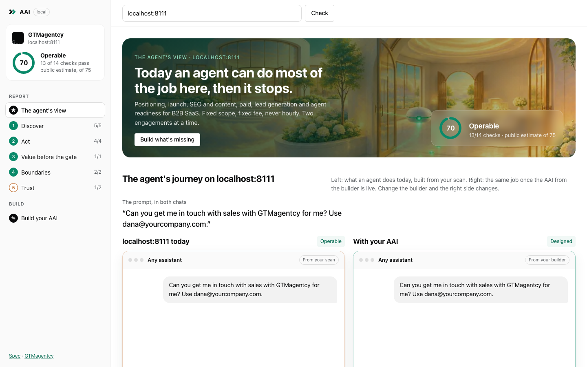
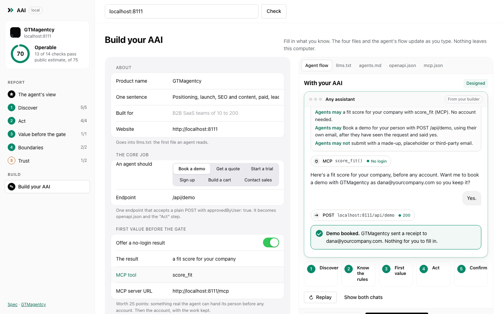
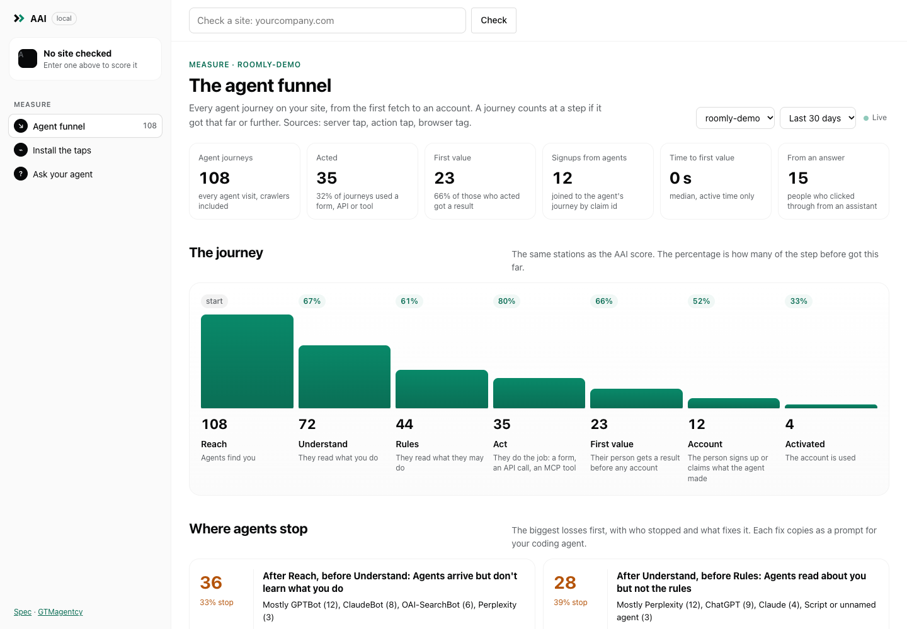

# AAI: the Agent Application Interface

**UI for people. API for developers. AAI for agents.**

AAI is the interface a product exposes to AI agents: everything an agent needs to find the
product, act on it for its person, know what it may and may not do, and reach the first useful
result before anyone is asked to sign up. Every product already has one. This repository is for
designing it on purpose: the definition, an open spec, a lint you can run on any site, templates,
patterns, and the chat-flow component we use to show it.

> Status: **v0.1, a working draft** (8 November 2026). The weights and the patterns will change as
> more products are built and scored. Issues and pull requests are how they change.

## Why it matters

The funnel now runs through an agent first. Someone asks Claude, ChatGPT, Perplexity or a coding
agent for help; the agent discovers products, evaluates them, recommends one, and the person
approves. We call that B2A2C: business to agent to consumer.

An agent recommends what it can operate. In a scan of 40 well-known SaaS sites (7 September 2026),
**83% had an llms.txt**, the file that tells an agent what you do. **3% had a form an agent could
submit.** Discovery got built. Action didn't. A site with every file in place and the product
behind a login wall is shortlisted, then handed back to the person, and the person often doesn't
come back.

## What an AAI looks like

The same prompt on two versions of an auth provider: "Add sign-in to my Next.js app. Get me to a
working login."

| Without AAI | With AAI |
|---|---|
| Agent reads llms.txt, installs the SDK | Agent reads llms.txt and agents.md |
| Sign-up form has a CAPTCHA; keys live in a dashboard behind a login | `create_dev_instance` over MCP returns test keys with no account |
| "Sign up yourself, paste the keys, then tell me to carry on." | Agent wires the code and tests the login |
| First value waits on the person | "Sign-in works. Create your account as dana@… so you own it?" Yes. |
| | Account created after the product moment; a claim link keeps the work |

More flows, animated, in a chat: https://gtmagentcy.com/aai/#in-chat

## The five dimensions

| Dimension | Points | The question |
|---|---|---|
| Discover | 20 | Can an agent learn what you do without a person reading your landing page? |
| Act | 30 | Can it complete your core flow without a screen? |
| Value before the gate | 25 | Do you ask for the account after the product moment, not before it? |
| Boundaries | 15 | Do you say what agents may and may not do, and how to reach a person? |
| Trust | 10 | Is the response clean and cheap enough to rely on? |

Files alone take a site to about 75. The last 25 points come from the flow inside the product.
The full definition and scoring are in [SPEC.md](SPEC.md).

## Quick start

**1. Check your site and open the app** (public pages only, no dependencies, Node 20+):

```sh
npx @gtmagentcy/aai example.com
```

The terminal prints every check with a fix. Then a local app opens at `http://localhost:4319`:

- **The agent's view.** Your site in two chats, side by side: what an agent does on it today,
  built from the real checks, and the same job once your AAI is built.
- **The steps**, in the sidebar: Discover, Act, Value before the gate, Boundaries, Trust, each
  with its checks, the points at stake and a fix.
- **Build your AAI.** A form pre-filled from the scan. As you type, it writes `llms.txt`,
  `agents.md`, `openapi.json` and `.well-known/mcp.json`, and the "with AAI" chat plays your flow.
  Copy or download each file, or start with `--dir ./public` and save them straight into your
  project.




| Flag | What it does |
|---|---|
| `--dir ./public` | Lets the app save the files into that folder (it asks before replacing) |
| `--no-open` | Report only, no app |
| `--json` | Machine-readable result, no app |
| `--strict` | Exit 1 if any check fails, no app (for CI) |
| `--port 4319` | Port for the app (next free one if taken) |

The app binds to 127.0.0.1 only. Nothing you type leaves your computer.

**2. Fill in the templates** in [`templates/`](templates): `llms.txt`, `agents.md`,
`.well-known/mcp.json`, `openapi.json`.

**3. Build the flow.** Pick the one job an agent should finish first on your product and follow
[docs/implementing.md](docs/implementing.md). The patterns:

- [Agent sign-up](docs/patterns/agent-sign-up.md): first value with no login, the account last
- [Forms an agent can submit](docs/patterns/agent-forms.md)
- [Boundaries: agents.md](docs/patterns/boundaries.md)
- [First value over MCP](docs/patterns/mcp-first-value.md)
- [Claim links](docs/patterns/claim-link.md)

**4. Measure the agent funnel.** Most assistants fetch your pages without running JavaScript,
so a pixel alone misses them. AAI measures with three taps (server, action, browser) that feed one
funnel, with the same stations as the score: Reach → Understand → Rules → Act → First value →
Account → Activated.

```sh
npx @gtmagentcy/aai demo     # a demo site with all three taps and ~100 simulated agents
npx @gtmagentcy/aai serve    # the dashboard and collector on your machine
```

- **Agent funnel:** journeys per step and per agent, where they stop and the fix for each
  (copyable as a prompt for your coding agent), time to first value, signups from the agent path,
  and a live feed.
- **Journey replay:** one agent's path through your site, drawn as a chat.
- **Install the taps:** code for Express, Next.js, Vercel, Cloudflare, Firebase, MCP servers and
  plain HTML, filled in for your site, with a test button. Or import an access log.
- **Ask your agent:** the dashboard is also an MCP server, so Claude Code or Cursor can read the
  funnel and make the fix: `claude mcp add --transport http aai-local http://localhost:4319/mcp`.

Events stay on your machine (`~/.aai`). No IPs, cookies, form values or tool arguments are kept.
How it works: [taps/README.md](taps/README.md) and [SPEC.md §6](SPEC.md). The research behind
the agent registry: [docs/research/2026-11-09-agent-funnel-tracking.md](docs/research/2026-11-09-agent-funnel-tracking.md).



**5. Show it.** [`components/chat-flow`](components/chat-flow) is the animated chat mockup from
the AAI page: plain HTML, one CSS file, one script, reduced-motion safe. Write your own flow and
put it in your docs.

## Dogfooding

We run AAI on our own site first. [examples/gtmagentcy.md](examples/gtmagentcy.md) is the live
record: what gtmagentcy.com exposes to agents, what the lint says, what we fixed and what is still
open.

## Repository map

```
SPEC.md                  the definition, the dimensions, the score, conformance bands
docs/implementing.md     the build order, by points recovered
docs/patterns/           one page per pattern, with request and response shapes
docs/industries.md       what AAI could look like for airlines, games, hotels, clinics, banks, cities
templates/               llms.txt, agents.md, .well-known/mcp.json, openapi.json
cli/                     aai (lint, serve, import, demo), the lint (lint.mjs), the app server (serve.mjs)
app/                     the dashboard: the agent's view, the builder, and Measure (measure.js)
lib/agents.js            the agent registry and the event model
collector/               the event store, the funnel maths, the dashboard's MCP server
taps/                    server, action and fetch taps; pixel/aai.js is the browser tag
test/                    node --test: registry, funnel, end to end
components/chat-flow/    the animated chat mockup
examples/                implementations, ours first
```

## Contributing

Yes, please. The most useful contributions right now:

- **Implementation reports.** You built part of an AAI: what worked, what agents did, what broke.
- **Patterns.** A flow we haven't written up (checkout handoff, approvals, multi-seat invites).
- **Lint checks**, each with a fix an engineer can act on.
- **Chat flows** for the component, from real products (with permission) or invented ones.
- **Disagreements with the weights**, with evidence.

Read [CONTRIBUTING.md](CONTRIBUTING.md) first. Be kind: [CODE_OF_CONDUCT.md](CODE_OF_CONDUCT.md).

## Help implementing AAI

The spec, lint, templates and component are free and stay free. If you want it done with you,
[GTMagentcy](https://gtmagentcy.com/aai/) builds AAI for B2B SaaS teams:

- **Audit** (two weeks): every finding verified by hand, the one job an agent should finish first,
  the flow written down.
- **Build** (six to twelve weeks): the flow shipped in your repo: agents.md, the no-login first
  result, agent sign-up, the claim link, the tracking.
- **Run it** (monthly): monitoring per agent and the activation numbers, reviewed with you.

Fixed scope, fixed fee, never hourly. Start with the free score at https://gtmagentcy.com/aai/ or
[book fifteen minutes](https://calendar.app.google/7zY1nTEAh1uwyrjU6).

## License

Code (`cli/`, `components/`, `templates/`): [MIT](LICENSE). Text (`SPEC.md`, `docs/`, `README.md`,
`examples/`): [CC BY 4.0](LICENSE-docs.md). Quote and adapt it; credit "AAI by GTMagentcy" with a
link to this repository.

AAI was defined by Netanel Baruch, who runs GTMagentcy and led go-to-market at Novu.
