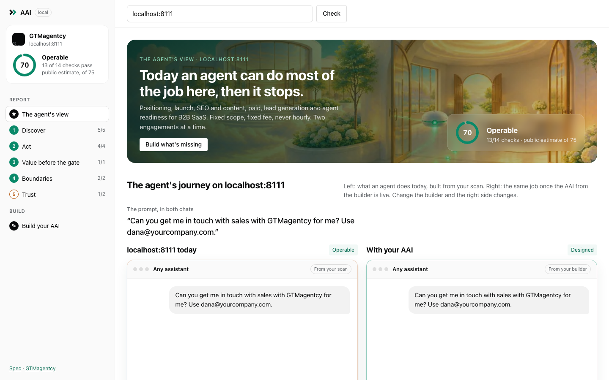
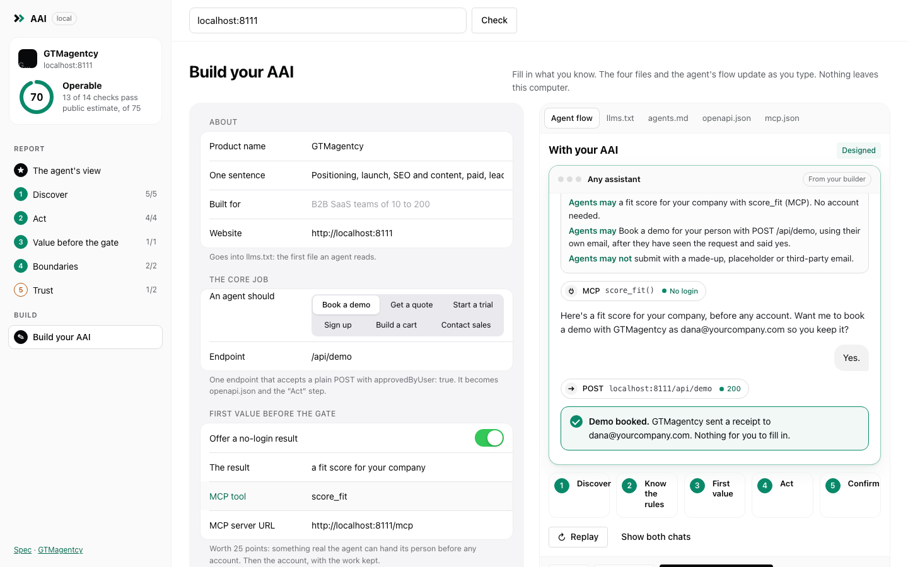

# AAI: what we built on 8 November 2026, and what to work on next

On 8 November 2026 AAI went from a definition to three working pieces, all local and unpublished.
First, the AAI landing page on gtmagentcy.com (branch `feat/aai-landing`) gained animated chat
examples, a sign-up before/after, an industries section, and a lighter hero film with a loader.
Second, gtmagentcy.com now dogfoods its own AAI: an OpenAPI description and an MCP server card,
which were the two checks it failed. Third, an open-source repo at `~/projects/aai` holds the spec
(v0.1), templates, patterns, the chat component, and `aai-lint`, a CLI that checks any site and
opens a local app. The app shows the agent's journey on that site and builds the missing files from
a form. Nothing is pushed, deployed or public; publishing waits for Netanel. The open list at the
end is what to work on next.

## 1. The AAI landing page (gtmagentcy.com/aai/, local)

Branch `feat/aai-landing`, http://localhost:8111/aai/. Commits `1271665`, `cbc2643`, `9008ee1`.

- **See it in the chat.** Animated chat mockups in four neutral styles (Claude, ChatGPT, Perplexity,
  Cursor; labels only, no logos). Each plays once when it scrolls into view and has Replay and
  "Show the whole chat". Beside each chat is a step list that lights up and links to the AAI score
  dimension it proves.
  1. **Self-serve sign-up, before/after (leads the section).** An invented auth provider,
     "Passline", in the style of Clerk. Without AAI, the coding agent stops at a CAPTCHA and a
     dashboard login. With AAI, it gets a dev instance with no login, wires up a working login,
     then signs the person up after a yes and hands over a claim link.
  2. **B2B SaaS: from an open question to a booked demo.** The person names no vendor. The agent
     finds five tools, ranks the one it can act on first ("I can book a demo"), then books.
  3. **E-commerce: product question to checkout.** MCP search, fit notes, a cart with no account;
     payment stays with the person.
  4. **Services: quote request.** Perplexity style with cited sources; the only mover with an agent
     form gets the request.
  5. **Developer tool: a trial before signup.** A sandbox key over MCP, working code, then a claim link.
- **Before and after AAI.** The same demo prompt on a failing site and an agent-ready one, with
  the scan numbers: 83% of 40 SaaS sites had an llms.txt, 3% had a form an agent could submit.
- **Industries.** "Now picture a whole industry with an AAI": airline, open-world video game (named
  generically, not GTA 6), hotel, clinic, bank, city hall. Each card has the prompt, the tool calls,
  the result, and what the business would publish.
- **Hero film and loading.** Re-encoded from 11.6 MB to 3.6 MB on desktop and from 6.3 MB to 2.0 MB
  on phones. A "Loading the film" pill shows progress, and a blurred placeholder paints first.
  Data-saver and 2G connections get the stills only.
- **Checks.** The axe accessibility checker found no problems on the new sections and the hero.
  There's no sideways scrolling on mobile, reduced motion shows the final frame, and the console
  shows no errors.


## 2. Dogfooding on gtmagentcy.com

Commit `dce1407` on `feat/aai-landing`.

- The live gtmagentcy.com passes 12 of 14 lint checks. The two failures were "no OpenAPI" and
  "no MCP server an agent can find". Our AAI score on 2026-11-08 was 56.
- Added `/openapi.json` (OpenAPI 3.1 for `POST /api/lead`, both sources) and
  `/.well-known/mcp.json` (points at `/api/mcp`). Both are listed in `agents.md` and `llms.txt`.
- **Found and fixed:** `/aai/` was missing from the publish allowlist (`.vercelignore`), so the AAI
  page would not have gone live on deploy. The deploy config now also ships `.well-known`.
- On the branch every check passes except HTTPS, which fails only because localhost is plain http.

## 3. The open-source repo (`~/projects/aai`, local git, no remote)

Commits `5cc86c4` and `6177a88`.

- `README.md`: the definition, the sign-up before/after, the five dimensions, a quick start, the
  dogfood record, how to contribute, and GTMagentcy's services (Audit, Build, Run it; no prices).
- `SPEC.md` v0.1: the definition, the dimensions with MUST and SHOULD, the score weights and the cap
  at 10, the four bands, the rules that keep the person in charge, and versioning.
- `docs/`: a 10-step build order, five patterns (agent sign-up, agent forms, boundaries, first
  value over MCP, claim links), and the industries.
- `templates/`: `llms.txt`, `agents.md`, `.well-known/mcp.json`, `openapi.json`.
- `components/chat-flow/`: the chat mockups as a standalone component with a demo page.
- `examples/gtmagentcy.md`: the dogfood record.
- `CONTRIBUTING`, a code of conduct, issue and PR templates, and a weekly workflow that lints
  gtmagentcy.com.
- Licences proposed: MIT for code, CC BY 4.0 for text ("AAI by GTMagentcy").

## 4. `aai-lint` and the local app

```sh
cd ~/projects/aai
node cli/aai-lint.mjs yoursite.com                 # report in the terminal, then the app opens
node cli/aai-lint.mjs yoursite.com --dir ./public  # the app can save files into ./public
```

- **The CLI** reads public pages only (about a dozen requests) and runs 14 checks across the five
  dimensions, each with a fix. It prints a public estimate out of 75. Flags: `--json`, `--strict`
  (for CI), `--no-open`, `--port`.
- **The app** runs at http://localhost:4319 and binds to 127.0.0.1 only.
  - The sidebar shows the site with its estimate ring, then the steps: the agent's view, the five
    dimensions with how many checks pass, and "Build your AAI".
  - **The agent's view:** a header image (the existing AAI story stills, no new Higgsfield
    credits). Below it, two chats: what an agent does on the site today, built from the real
    checks, and the same job with AAI. Then bars per dimension and the gaps ranked by points,
    each with "Build it".
  - **Dimension pages:** every check with what was found, the fix, and a link into the builder.
  - **The builder:** an Apple-HIG-style grouped form, pre-filled from the scan: core job, endpoint,
    a no-login first value (on/off switch), MCP tool and URL, rules, contacts, facts. As you type,
    the four files and the "with AAI" chat update live. You can copy or download each file, or
    use "Save all" (with `--dir`), which asks before replacing a file.
- **Tested** on gtmagentcy (local and live) and on linear.app (public pages only). Saving works,
  there's no sideways scrolling on mobile, and the console shows no errors.




## 5. What to work on next

**Waiting on Netanel**
- [ ] Publish the repo: where (`gtmagentcy/aai` by default, or the `gtmagentcy` org) and when.
      The AAI announcement has been held on social since 2026-10-24. Command:
      `cd ~/projects/aai && gh repo create gtmagentcy/aai --public --source . --push`
- [ ] Confirm the licences (MIT for code, CC BY 4.0 for text).
- [ ] Deploy gtmagentcy.com from `feat/aai-landing` so `/aai/`, `/openapi.json` and
      `/.well-known/mcp.json` go live.
- [ ] Real names on the page: keep the invented "Passline", or name Clerk and Novu (ideally with
      their OK).
- [ ] Whether the AgentReady scanner is open-sourced too (the repo ships only the lint).

**Product work on the CLI and app**
- [ ] The "today" chat counts any form an agent could submit, even one that isn't for the core job.
      On gtmagentcy it found the scan box and said "This works today". Detect which form matches
      the core job; read the OpenAPI/agents.md endpoint when there is one.
- [ ] Find MCP servers on other domains (for example `mcp.linear.app`): links in llms.txt and
      agents.md, and `mcp.<domain>`.
- [ ] A "walk-through" mode for Value before the gate: guided questions that score the 25 points
      the site can't show.
- [ ] Re-run after deploy: a diff of before and after, and the score moving.
- [ ] Publish to npm as `aai-lint` so `npx aai-lint yoursite.com` works without GitHub.
- [ ] More chat flows for the component (checkout, approvals, multi-seat invites).

**After publishing**
- [ ] A GitHub link and an "Open source" block on /aai/ and /open-source/, and a line in llms.txt.
- [ ] Re-score gtmagentcy.com and add the row to `examples/gtmagentcy.md`.
- [ ] Walk gtmagentcy's own Value before the gate by hand.

## Where things are

- Landing page: `~/projects/gtmagentcy`, branch `feat/aai-landing`, http://localhost:8111/aai/
- Repo: `~/projects/aai` (spec, CLI, app, component)
- Screenshots: `~/projects/gtmagentcy/creative/aai-chat/screens/`, `~/projects/aai/docs/img/`
- HQ files: `~/projects/netanel/projects-hq/hq/aai.md`, `hq/gtmagentcy.md`
