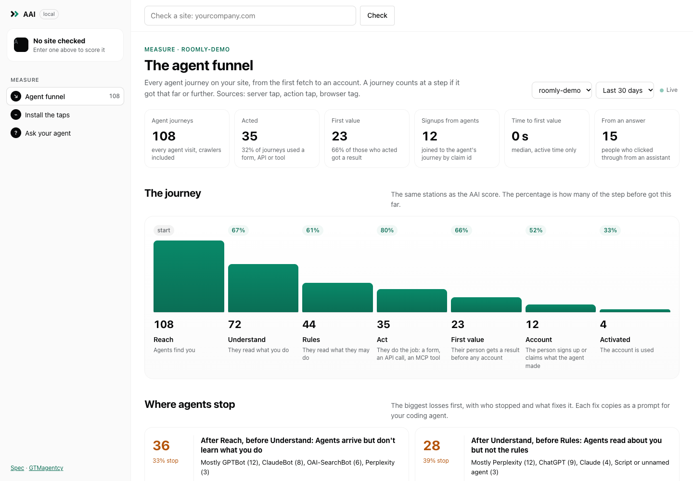

# AAI open source: the local dashboard and the agent-funnel pixel

On 9 November 2026 the open-source AAI repo went from "score a site and build its files" to also
measuring what agents actually do on it. Run locally, `aai serve` opens a dashboard with the
agent funnel: Reach → Understand → Rules → Act → First value → Account → Activated, the same
stations as the AAI score. The "pixel" a site installs is three taps, not one script:
- a server tap, because ChatGPT, Claude and Perplexity fetch pages without running JavaScript;
- an action tap on the MCP server or API, which issues a claim id that joins the agent's work to
  the signup;
- a browser tag for people arriving from an assistant's answer.

The dashboard is also an MCP server, so the owner's own coding agent can read the funnel and make
the fix. Everything runs on the owner's machine with no dependencies. A demo site with all three
taps proves it end to end, and 12 tests pass. The repo is public on GitHub under
the GTMagentcy organisation (github.com/gtmagentcy/aai) since 9 November 2026. A hosted collector (the paid line) is
the next decision.



## 1. Why three taps, not one pixel

The research behind this is in [docs/research/2026-11-09-agent-funnel-tracking.md](../research/2026-11-09-agent-funnel-tracking.md), with sources.

- **Most named agents don't run JavaScript.** GPTBot, OAI-SearchBot, ChatGPT-User, ClaudeBot,
  PerplexityBot and Meta's crawler fetch raw HTML only. A JS pixel never sees them. Only the
  server sees them, by User-Agent.
- **Browser agents run JavaScript but look like Chrome.** These are ChatGPT agent, Atlas, Comet,
  Claude in Chrome and Google-Agent. The ones that identify do it in headers: `Claude-Agent`,
  `Google-Agent`, or ChatGPT agent's `Signature-Agent: "https://chatgpt.com"` (Web Bot Auth,
  still an IETF draft). A client-side check like `navigator.webdriver` is a heuristic and is
  labelled as one.
- **Referrals are fragile.** Since about 7 October 2026, reports say ChatGPT drops both the
  referrer and `utm_source`. OpenAI has not confirmed this. That is why attribution rides on a
  claim id that we issue, not on the referrer.
- **Nobody measures the action.** Cloudflare AI Crawl Control, Vercel's AI Traffic, Known Agents
  (formerly Dark Visitors), Profound, Scrunch and Knowatoa measure crawls and referrals. Profound
  gets conversions only through GA4. None is open source. No product measures an agent acting,
  the person getting a first value, and the signup that follows. That is the gap AAI fills.

## 2. What was built (`~/projects/aai`, version 0.3.0)

| Piece | File | What it does |
|---|---|---|
| Agent registry | `lib/agents.js` | 34 agents. Each has its vendor, its kind (chat fetch, browser, coding, AI search, crawler, script, referral), whether it runs JS, and how to verify it (IP list or signature). Order matters, so Claude Code is matched before Claude-User. Unconfirmed tokens are marked. |
| Event model | `lib/agents.js`, `SPEC.md` §6 | 12 events mapped to the 7 steps. Crawlers only ever count at Reach. Normative in spec v0.2. |
| Server tap | `taps/node.js`, `taps/fetch.js` | Express/Connect/Firebase, plus Next.js, Vercel, Cloudflare Workers, Deno and Bun. It reports agent UAs, signed agents, and any read of llms.txt, agents.md, OpenAPI or the MCP card. |
| Action tap | `taps/mcp.js` | `mcpTap` counts MCP sessions and tool calls, marks first-value tools, issues a claim id and builds the claim link. `apiTap` does the same for plain API routes. |
| Browser tag | `pixel/aai.js` | Assistant referrals (referrer or utm), `?via=agent`, browser agents (heuristic), prompt copies, forms marked `data-aai-form`, and `aai.track()`. A human visit sends nothing. |
| Collector | `collector/store.js`, `cli/serve.mjs` | `POST /e`, a JSONL file per site under `~/.aai`, and the funnel maths. Journeys are joined by session and claim id. Time to first value counts active time only, with gaps under 15 minutes. |
| Log import | `lib/logs.js`, `aai import` | For a site with no code yet: reads an nginx or Apache access log. IPs are hashed, then dropped. |
| Dashboard | `app/measure.js`, `app/measure.css` | Agent funnel (KPIs, the journey map, where agents stop with the fix as a prompt, agent × step matrix, recent journeys, live feed). Journey replay drawn with the landing page's chat component. Install the taps (8 stacks, filled in, test button). Ask your agent. |
| MCP server | `collector/mcp.js` | `POST /mcp`, read-only: `list_sites`, `get_funnel`, `get_drop_offs`, `get_journey`, `get_fix_prompt`, `get_install_snippet`. |
| Demo | `examples/demo-site/demo.mjs`, `aai demo` | An invented product, "Roomly", with all three taps installed and 93 simulated agents walking it over real HTTP. |
| Tests | `test/` | 12 tests: the registry, privacy (no IP, form values or UA stored), the funnel maths, the store, and an end-to-end run through all three taps. CI on Node 20, 22 and 24. |

**Privacy, by design:**
- No IPs, cookies, form values, tool arguments or results are stored.
- The session id is a daily hash computed on the site's own server.
- The dashboard answers only on the machine it runs on. With `--host`, only `POST /e` and
  `/aai.js` are open to the outside.

### Run it

```sh
cd ~/projects/aai
node cli/aai.mjs demo            # demo site + simulated agents, then the dashboard
node cli/aai.mjs serve           # dashboard + collector (http://localhost:4319/#funnel)
node cli/aai.mjs gtmagentcy.com  # lint + agent's view + builder, with Measure in the sidebar
node --test test/
```

Connect an agent: `claude mcp add --transport http aai-local http://localhost:4319/mcp`.

### Verified on 2026-11-09

- The demo funnel was Reach 104 → Understand 69 → Rules 41 → Act 32 → First value 23 → Account
  12 → Activated 4, with 12 signups joined to their agent's journey by claim id. All three
  sources reported.
- A full journey replays in order: llms.txt → agents.md → MCP → `get_quote()` → first value →
  claim link → signup → activated.
- The MCP server returns drop-offs and fix prompts.
- On Install, "Send a test event" makes the round trip through the collector and the live stream.
- At 390 px there is no sideways scroll. The only console error is the live stream being cut off
  when the page navigates away, which is expected.

## 3. Roadmap (GitHub milestones)

1. **M1: Funnel v0.3**. Done today, and everything above.
2. **M2: Dogfood on gtmagentcy.com**:
   - Server tap on the Firebase functions behind `api/mcp.js` and `api/lead.js`. `request_meeting`
     is a real Act → Account event.
   - Browser tag on `/aai/` and `/live/`.
   - Hosting logs imported for llms.txt and agents.md, which Firebase serves statically.
   - Needs a collector the site can reach, and a deploy (your word).
3. **M3: Verification**:
   - Check agents against their vendors' published IP lists (refreshed daily).
   - Verify Web Bot Auth signatures against the key directories (ChatGPT agent now, Google's
     `agent.bot.goog` when it ships).
   - The dashboard shows verified, unverified and spoofed separately.
4. **M4: Score and funnel together**: the lint's simulated journey beside the measured one, fix
   markers on a score-over-time line, and regressions ("Claude stopped passing Rules on…").
5. **M5: Hosted collector (the paid line)**. The same tag points at `data-endpoint`, with
   accounts, retention and alerts. This is where First Value (`~/projects/agent-onboarding`)
   becomes the hosted product on top of the open-source core.
6. **M6: Launch**: npm package, public repo, a GitHub link on /aai/, a "measure your agent funnel"
   section, and an announcement post.

## 3b. Dogfood: gtmagentcy.com, locally (2026-11-09)

All three taps run on gtmagentcy's local dev server, behind `AAI_COLLECTOR`, with production
untouched. A walk of 67 documented agents went through the real endpoints:
Reach 68 → Understand 45 → Rules 28 → Act 19 → First value 13 (choose_model) → Account 4
(request_meeting). A real browser visit with `utm_source=chatgpt.com` counted as a ChatGPT referral.

It found a real gap: agents.md points agents at `/services/<slug>.html` for "agent readiness", but
that page doesn't exist and returns a 404. It also improved the product: drop-off advice now reads
the lint (when agents.md exists, the advice is about agents reaching it), and crawlers no longer
count as drop-offs. The record and how to run it: [examples/gtmagentcy.md](../../examples/gtmagentcy.md).

## 4. Decisions for Netanel

- [x] **The npm name:** `@gtmagentcy/aai` (the npm user `gtmagentcy` owns the scope). Published 0.4.0 on 2026-11-10: https://www.npmjs.com/package/@gtmagentcy/aai
- [x] **The repo is public**, under the gtmagentcy organization (Netanel, 2026-11-09).
- [ ] **Dogfood on gtmagentcy.com (M2).** This changes the live site's functions and needs a
      reachable collector: a small always-on server, or wait for the hosted one.
- [ ] **The hosted collector (M5).** Whether First Value becomes it, and when.
- [x] Licences confirmed (Netanel, "do all", 2026-11-09): MIT for code, CC BY 4.0 for the spec and docs.

## 5. Limits, said plainly

- The demo's agents are simulated by the user-agents their vendors document. No model is called.
  Real numbers start when a site installs the taps.
- Browser agents that look exactly like Chrome are invisible unless they come through a referral,
  an agent link or a claim link. The heuristic flag is labelled as one.
- The JSONL store is fine up to a few hundred thousand events. Beyond that, use a hosted
  collector.
- Several registry tokens (Comet, Cursor, Codex, Devin, MCP clients) come from secondary sources
  and are marked unconfirmed.
